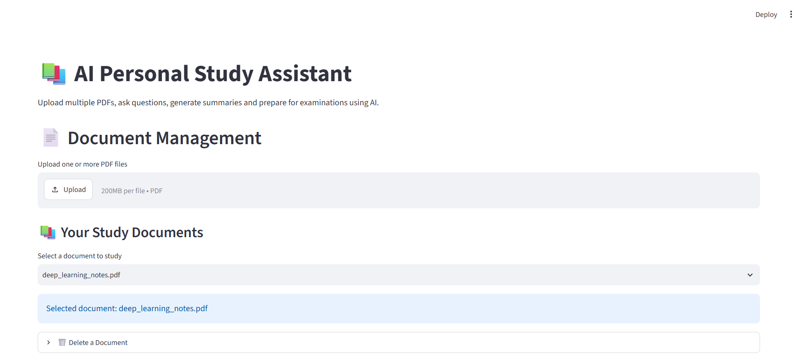
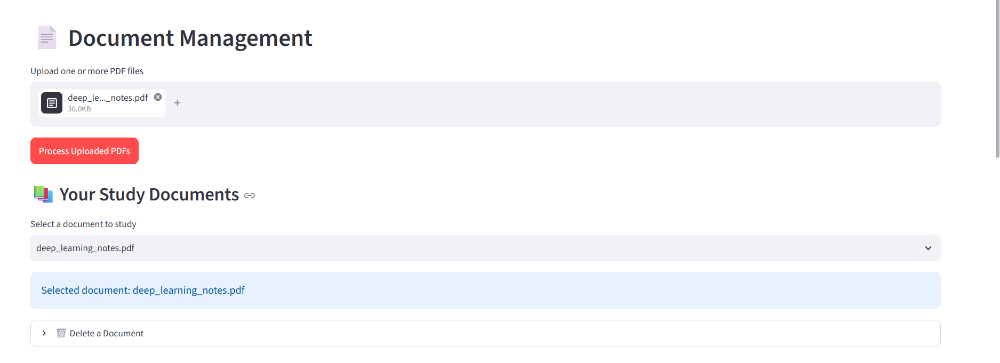
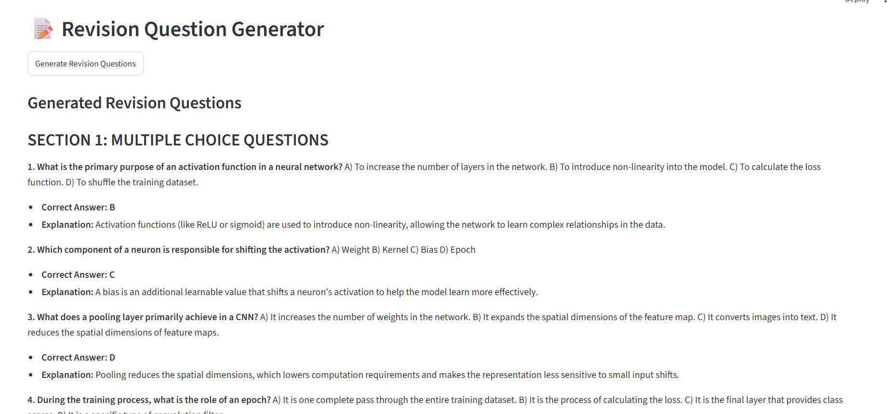
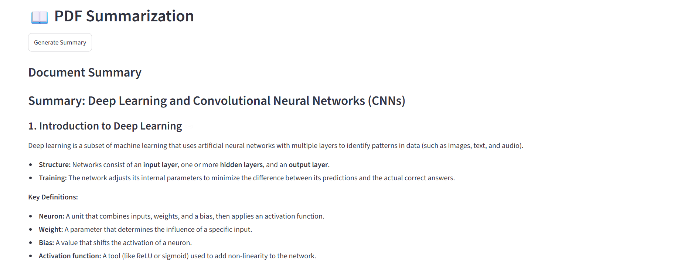
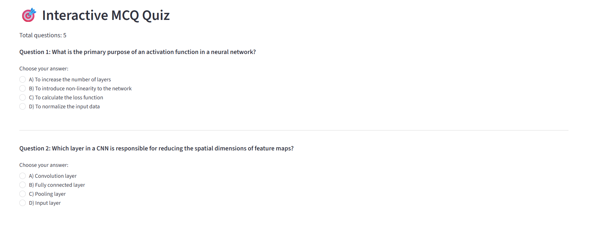

# AI Personal Study Assistant

An AI-powered document-based learning assistant built using Retrieval-Augmented Generation (RAG). The application enables students to interact with PDF study materials, retrieve relevant information, generate summaries, and prepare for examinations using AI.

## Project Overview

The AI Personal Study Assistant is designed to simplify the learning process by combining semantic search, vector databases, and Large Language Models (LLMs).

Users can upload multiple PDF documents, ask questions about their study materials, receive context-based answers with source references, generate structured summaries, and create examination-oriented revision questions.

The application uses a Retrieval-Augmented Generation (RAG) pipeline to retrieve relevant information from uploaded documents before generating responses.

## Key Features

### Document Management
- Upload and process multiple PDF documents.
- Extract text while preserving page information.
- Select and manage indexed documents.
- Delete documents from the vector database.

### Retrieval-Augmented Question Answering
- Ask natural-language questions about uploaded documents.
- Retrieve relevant passages using semantic search.
- Generate context-grounded answers using Google Gemini.
- Display source passages and corresponding page numbers.
- Filter retrieval based on the selected document.

### Document Summarization
- Generate structured summaries from PDF documents.
- Identify important concepts and definitions.
- Present information using headings and bullet points.

### Examination Preparation
- Generate multiple-choice questions (MCQs).
- Generate short-answer questions.
- Generate long-answer questions.
- Provide answers and explanations based on uploaded material.

### Interactive Quiz
- Attempt generated MCQs interactively.
- Submit answers and calculate scores.
- Display correct answers and explanations.
- Restart quizzes for additional practice.

### Chat History
- Maintain question-and-answer history during the application session.
- Review previous responses and supporting document references.
- Clear conversation history.

## Technology Stack

| Category | Technology |
|---|---|
| Programming Language | Python |
| Frontend Framework | Streamlit |
| PDF Processing | PyMuPDF |
| Embedding Framework | Sentence Transformers |
| Embedding Model | all-MiniLM-L6-v2 |
| Vector Database | ChromaDB |
| Large Language Model | Google Gemini |
| Environment Management | python-dotenv |
| Version Control | Git and GitHub |

## System Architecture

The application follows a Retrieval-Augmented Generation architecture.

```text
             PDF Documents
                   |
                   v
             Text Extraction
                   |
                   v
              Text Chunking
                   |
                   v
          Embedding Generation
                   |
                   v
             ChromaDB Storage
                   |
                   |
             User Question
                   |
                   v
          Question Embedding
                   |
                   v
           Semantic Retrieval
                   |
                   v
        Relevant Document Chunks
                   |
                   v
             Google Gemini
                   |
                   v
          Context-Based Answer
                   |
                   v
       Answer and Source References
```

## Project Structure

```text
AI-Personal-Study-Assistant/
|
|-- app/
|   |-- embedding_generator.py
|   |-- list_models.py
|   |-- llm_generator.py
|   |-- main.py
|   |-- pdf_reader.py
|   |-- process_document.py
|   |-- process_embeddings.py
|   |-- question_generator.py
|   |-- rag_pipeline.py
|   |-- retriever.py
|   |-- streamlit_app.py
|   |-- summarizer.py
|   |-- text_chunker.py
|   |-- vector_store.py
|
|-- data/
|   |-- documents/
|   |-- chroma_db/
|
|-- tests/
|
|-- .env.example
|-- .gitignore
|-- requirements.txt
|-- README.md
```

## Application Screenshots

### Home Page


### Document Management


### AI Question Answering


### PDF Summarization


### Interactive Quiz


## Installation and Setup

### Prerequisites

- Python 3.10 or later
- Git
- Google Gemini API key

### 1. Clone the Repository

```bash
git clone https://github.com/akhilav-28/AI-Personal-Study-Assistant.git
```

### 2. Navigate to the Project Directory

```bash
cd AI-Personal-Study-Assistant
```

### 3. Create a Virtual Environment

```bash
python -m venv venv
```

### 4. Activate the Virtual Environment

For Windows PowerShell:

```powershell
.\venv\Scripts\Activate.ps1
```

### 5. Install Dependencies

```bash
pip install -r requirements.txt
```

### 6. Configure Environment Variables

Create a `.env` file in the project root directory and configure your Gemini API key.

```env
GEMINI_API_KEY=your_gemini_api_key
```

Obtain an API key from [Google AI Studio](https://aistudio.google.com/).

Do not commit API keys or other sensitive credentials to the repository.

### 7. Run the Application

```bash
streamlit run app/streamlit_app.py
```

The application will be available locally in your web browser.

## Application Workflow

1. Upload one or more PDF study documents.
2. Extract and preprocess document content.
3. Divide extracted text into manageable chunks.
4. Generate vector embeddings using Sentence Transformers.
5. Store document chunks and metadata in ChromaDB.
6. Retrieve relevant content through semantic similarity search.
7. Generate context-based responses using Google Gemini.
8. Display answers with supporting source references.
9. Generate summaries and examination revision questions.
10. Attempt interactive quizzes and evaluate results.

## Future Enhancements

- OCR integration for scanned PDF documents.
- Persistent conversation history.
- Export summaries and revision questions as PDF.
- User authentication and personalized study spaces.
- Advanced quiz generation with configurable difficulty levels.
- Cloud deployment and scalable document storage.

## Author

**Akhil A V**

Integrated MSc Computer Science (Artificial Intelligence and Machine Learning)  
Bharata Mata College, Mahatma Gandhi University

GitHub: https://github.com/akhilav-28

## License

No license has currently been assigned to this repository.